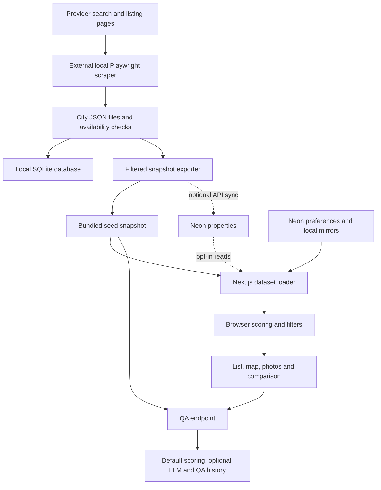

# Moradia Radar — end-to-end analysis

Reviewed October 16, 2026. Scope: the current working version of `apps/moradia`, its shared dependencies and CI, and the external local scraper that supplies its data. This was an analysis; application code and data were not edited.

**Assessment.** Moradia is a substantial personal housing decision tool with a useful discovery workflow and deterministic, adjustable rankings. Its main weakness is the reliability of the evidence behind those rankings. Existing prices are not refreshed through the normal ingestion path; unknown attributes sometimes become definite facts; map positions are displaced; and explanations do not fully reproduce the scores. Persistence and deployment also depend on a mixture of database rows, bundled files, temporary files and an external workstation directory.

The best next investment is to make collection, scoring, explanations and saved state agree before adding more ranking rules.

**Scope and reproducibility**

Files changed from another process during review. The analytical measurements below use a source snapshot captured at **23:20:42 UTC / 20:20:42 São Paulo**, stored locally at `/private/tmp/moradia-analysis-20261016`. Its `manifest.json` records source hashes. The scoring engine hash is `0778ad9bfe39ecda3d0f7680816a475212ae4189a3a5647863e5fde1a9eb45e5`. Links point to the working files; subsequent edits can move their lines or resolve findings.

The review included source tracing, aggregate JSON inspection, existing checks and isolated synthetic reproductions. It did not query production databases, exercise deployed write endpoints, run a real scrape, inspect hosting access controls, or verify property facts against live listings. Browser appearance and measured production performance remain unverified.

**1. Origin and product intent**

The original specification describes a personal move: compare neighborhoods near offices, retain existing furniture, prefer useful floor plans and parking, and prioritize building condition, greenery, walkability and commute. It contains a manually curated ranking of 20 neighborhoods. Its original budget and area bounds differ from current defaults, so it is historical context rather than the current executable specification. See [original criteria and neighborhood report](/Users/joao.guilherme/.cursor/Empty/relatorio_moradia_nubank.md:1).

The repository contains four Moradia commits, all dated October 16: initial portal, mobile spacing, shared preferences in Neon, and three furniture tiers. The working version adds substantial scoring, filtering, geocoding and QA changes; the chat drawer was untracked when reviewed. A checkout of the latest commit therefore does not reproduce everything analyzed here.

Current built-in defaults include an ideal monthly total of R$5,500, maximum R$6,500, hard cap R$6,850, and area 40–95 m². These are configurable preference settings, not independently justified market thresholds. São Paulo and Campinas also receive explicit regional penalties. See [default weights](/Users/joao.guilherme/dev/nu/data-projects/apps/moradia/src/lib/scoring-engine.ts:12) and [regional adjustments](/Users/joao.guilherme/dev/nu/data-projects/apps/moradia/src/lib/scoring-engine.ts:3069).

**2. The complete system**

The external workspace is `/Users/joao.guilherme/.cursor/Empty`. Despite its unrelated package name, it contains the property parsers, merge logic, SQLite store, search runner and exporter. The portal hardcodes that directory in its scrape API. See [scrape launcher](/Users/joao.guilherme/dev/nu/data-projects/apps/moradia/src/app/api/scrape/run/route.ts:12).

Collection supports QuintoAndar, Zap Imóveis, VivaReal, Netimóveis and ImovelWeb. Provider parsers normalize descriptions, costs, dimensions, amenities, photos and availability. Merge logic uses provider IDs and cross-provider heuristics to identify repeated listings. The job updates city JSON, mirrors into SQLite, then runs the exporter. The exporter reads the city JSON directly; SQLite is not the portal's serving database. See [job handoff](/Users/joao.guilherme/.cursor/Empty/scripts/scrape-sync-job.ts:189).

The exporter applies neighborhood allowlists, monthly total R$1,500–8,000, area 35–100 m² and a modernity threshold, with exceptions for favorites or audits. The browser can only filter the retained inventory: relaxing a UI filter cannot recover listings already discarded upstream. This is a curated sample, not a representative rental-market dataset. See [export filters](/Users/joao.guilherme/.cursor/Empty/scripts/push-to-portal.ts:189).

The portal normally loads a bundled JSON snapshot. Neon property reads require `MORADIA_USE_NEON_PROPERTIES=true`; a newer local snapshot can override them. Preferences use Neon whenever configured, with file fallbacks. The server page sends all properties to the client, which computes rankings and applies filters. See [dataset selection](/Users/joao.guilherme/dev/nu/data-projects/apps/moradia/src/lib/dataset-store.ts:160) and [server entry](/Users/joao.guilherme/dev/nu/data-projects/apps/moradia/src/app/page.tsx:6).

**3. Inventory and evidence quality**

| Measure | Reviewed snapshot |
|---|---:|
| Listings | 5,133 |
| Active / inactive flags | 5,100 / 33 |
| Eligible under built-in weights | 2,549 |
| Curated neighborhoods | 20 |
| Listings matching those neighborhoods | 2,955 |
| Listings using other neighborhood calibrations | 2,178 |
| Duplicate provider-plus-ID keys / duplicate URLs | 0 / 0 |
| Missing construction year | 4,802 — 93.6% |
| Missing exact floor | 3,971 — 77.4% |
| Missing total floors | 4,083 — 79.5% |
| Missing nearby-place data | 3,396 — 66.2% |
| Unknown raw furnished Boolean | 1,471 — 28.7% |

City counts are BH 1,166, RJ 690, Campinas 939, São Paulo 2,284, and Brasília benchmark 54. Provider counts are QuintoAndar 2,649, Zap 2,080, VivaReal 273, ImovelWeb 96 and Netimóveis 35. Zero duplicate keys does not prove zero duplicate physical apartments.

The README still describes more than 2,400 listings and four cities; it does not explain the Brasília benchmark. Counts above are computed from [the snapshot](/Users/joao.guilherme/dev/nu/data-projects/apps/moradia/src/data/seed-snapshot.json:1), rather than inferred from documentation.

The model has no per-field confidence, evidence timestamp or verification provenance. Neighborhood safety, commute and quality scores are hardcoded judgments without source/date metadata. Their numerical precision should not be interpreted as independently measured accuracy. Missing exact floor can coexist with a useful floor range, so the missing-floor count does not mean all those listings lack floor information. See [property types](/Users/joao.guilherme/dev/nu/data-projects/apps/moradia/src/types/moradia.ts:65).

For 1,738 listings, all QuintoAndar, total monthly cost exceeds rent + condominium + IPTU by R$43–223, with median R$138. Upstream types support insurance and service charges, while the portal drops those components. Additional fees are a plausible explanation; an incorrect total is not established. The cost explanation should expose those fees or an explicit residual instead of implying that three displayed components fully reconcile.

**4. Ranking model**

Neighborhood scoring begins with five 0–10 metrics: urban breathing, commute, building stock, budget fit and street safety. It computes a weighted mean, applies additional preference adjustments and clamps the neighborhood score to 1–10. Hardcoded calibrations and street-level heuristics can further cap selected metrics. The weights therefore do not behave as simple percentage contributions. See [neighborhood computation](/Users/joao.guilherme/dev/nu/data-projects/apps/moradia/src/lib/scoring-engine.ts:296).

The property score is an additive point total:

`neighborhood + direct safety + direct commute + city preference + modernity + nuances + budget + furniture + area + parking`

It is not a percentage, probability or normalized 0–100 score. Modernity starts from the supplied 0–100 input, applies a multiplier and a nonlinear bonus/penalty. Nuances include inferred floor, light, noise, surroundings and building characteristics. Budget and area use step bands. Furniture distinguishes unfurnished, semi-furnished and fully furnished. Eligibility is separate: price, area, required parking, inferred lack of elevator, trapped parking and modernity can eliminate a listing. Some rules vary by city. See [score total and exclusions](/Users/joao.guilherme/dev/nu/data-projects/apps/moradia/src/lib/scoring-engine.ts:3073).

Ordering is eligible first, then descending score, then lower monthly total. Exact ties retain input order. Inactive status is filtered later in the UI. Brasília is treated as a benchmark with separate overall-rank handling. Neighborhood ranks use raw neighborhood text, which can split aliases into separate groups.

This is a deterministic personal preference model. Safety, commute, modernity and amenities can influence several components at once. That can be intentional, but their cumulative influence needs to be visible and tested; changing one slider can affect more than one term.

**5. User journey**

The server supplies inventory and preferences. The browser restores filters, weights, favorites, comparison choices and view mode, then recalculates rankings. Users can narrow by city, neighborhood, price, area, floor, commute, furnishings, features, provider and availability; switch between list, split and map views; inspect galleries and score explanations; compare up to four properties; and open the source listing. See [portal state and scoring](/Users/joao.guilherme/dev/nu/data-projects/apps/moradia/src/components/moradia-portal.tsx:1672).

Photos start with samples and load fuller galleries lazily. Geocoding combines static neighborhood/street coordinates, deterministic offsets, caches and limited live lookups. Distances use coordinates rather than road routing; commute minutes come from textual neighborhood estimates. The two measures should not be presented as equivalent.

Questions attach a property snapshot and filtered-list context. The backend independently loads the disk snapshot and evaluates default weights, then produces a deterministic answer or uses Groq when configured. It persists QA history and attempts to append an event to a local Cursor queue. Checking a Google key does not result in a Google call in the reviewed implementation. This is not evidence of an active human/agent session connection. See [QA evaluation](/Users/joao.guilherme/dev/nu/data-projects/apps/moradia/src/app/api/qa/route.ts:333) and [question handling](/Users/joao.guilherme/dev/nu/data-projects/apps/moradia/src/app/api/qa/route.ts:1014).

**6. Findings that should drive the next work**

Priorities express implementation urgency. P1 security impact depends on who can reach the deployment; hosting protection was not inspected.

| Priority | Finding and evidence | Consequence and correction |
|---|---|---|
| P1 | Photo API accepts an arbitrary URL and fetches it without destination validation. [Route](/Users/joao.guilherme/dev/nu/data-projects/apps/moradia/src/app/api/photos/route.ts:371) | A mocked execution forwarded a loopback URL unchanged: a server-side request forgery primitive. Resolve URLs from validated stored listing IDs; restrict destinations and redirects. |
| P1 if exposed | Preferences, favorites, QA mutation and scraper controls lack application authentication. Sync checks a bearer secret only when configured. [Sync guard](/Users/joao.guilherme/dev/nu/data-projects/apps/moradia/src/app/api/sync/route.ts:8), [QA actions](/Users/joao.guilherme/dev/nu/data-projects/apps/moradia/src/app/api/qa/route.ts:913) | Shared household state and costly operations need a verified access boundary. Fail closed on missing sync credentials; validate and bound inputs. Shared state itself may be intentional. |
| P1 for decision quality | Normal ingestion skips known detail pages and merge discards incoming details for duplicates. [Skip](/Users/joao.guilherme/.cursor/Empty/scripts/scrape-sync-job.ts:541), [merge](/Users/joao.guilherme/.cursor/Empty/src/imoveis/merge.ts:324) | Synthetic rent update 3,000 → 4,000 remained 3,000. Refresh known listings on a schedule and retain per-listing verification timestamps. Dataset export time is not listing freshness. |
| P1 for decision quality | Map coordinates are deliberately moved into spirals and repelled from nearby pins/offices. [Displacement](/Users/joao.guilherme/dev/nu/data-projects/apps/moradia/src/components/property-map-view.tsx:273) | Pins and connection lines can imply the wrong street/location and move after sorting. Preserve coordinates; cluster or spiderfy presentation; disclose estimated precision. Distance text is calculated before displacement and can disagree visually with the line. |
| P2 | Unknown availability is represented as active; verification can reactivate an inactive property after HTTP 403/429/server errors. Export also marks photo-less listings inactive. [Check](/Users/joao.guilherme/.cursor/Empty/src/imoveis/scrape.ts:786), [reactivation](/Users/joao.guilherme/.cursor/Empty/scripts/scrape-sync-job.ts:311), [photo rule](/Users/joao.guilherme/.cursor/Empty/scripts/push-to-portal.ts:277) | Synthetic HTTP 403 changed inactive to active. Use active/inactive/unknown with separate photo completeness and preserve prior state when verification is inconclusive. |
| P2 | Exported score breakdown omits direct safety, commute and city adjustments. [Total](/Users/joao.guilherme/dev/nu/data-projects/apps/moradia/src/lib/scoring-engine.ts:3073), [breakdown](/Users/joao.guilherme/dev/nu/data-projects/apps/moradia/src/lib/scoring-engine.ts:3185) | Breakdown differs from final score on 4,974 listings; omitted net adjustment ranges from −52.3 to +10 points. Export every term and assert exact reconciliation after rounding. Modernity explanation also omits its nonlinear delta. |
| P2 | Absence of elevator text becomes “no elevator”; unknown furniture becomes unfurnished. [Elevator inference](/Users/joao.guilherme/dev/nu/data-projects/apps/moradia/src/lib/scoring-engine.ts:1141), [furniture conversion](/Users/joao.guilherme/dev/nu/data-projects/apps/moradia/src/lib/scoring-engine.ts:3004) | 1,306 listings lack elevator evidence; 1,356 raw unknown furniture values become unfurnished. Unknown evidence can produce hard exclusions or full bonuses. Preserve a distinct unknown state. |
| P2 | Furniture detection mishandles placeholders and mixed evidence. [Classifier](/Users/joao.guilherme/dev/nu/data-projects/apps/moradia/src/lib/scoring-engine.ts:2723) | “Espaço para cama de casal” becomes fully furnished; an actual refrigerator plus space for a washing machine becomes unfurnished. Scope negation/placeholder handling to each item. |
| P2 | New area bands ignore sweet-spot settings and leave decimal gaps. [Area scoring](/Users/joao.guilherme/dev/nu/data-projects/apps/moradia/src/lib/scoring-engine.ts:3030) | Synthetic 72 m² gets +10, 72.5 gets −10, 73 gets +6. No current snapshot row falls in the gap, but the schema allows decimals. Use continuous boundaries and configured settings. |
| P2 | QA uses the disk dataset and default weights over the visible customized result. [Default evaluation](/Users/joao.guilherme/dev/nu/data-projects/apps/moradia/src/app/api/qa/route.ts:342), [answer precedence](/Users/joao.guilherme/dev/nu/data-projects/apps/moradia/src/app/api/qa/route.ts:672) | Asking why a card ranks where it does can explain another score. Pass a validated evaluation context/version or share the same evaluation service. Also derive furniture wording from the tier: 237 semi-furnished rows retain a true Boolean that wins over the tier in QA. |
| P2 | Preference writes can lose newer changes or acknowledge nondurable saves. [Client save](/Users/joao.guilherme/dev/nu/data-projects/apps/moradia/src/components/moradia-portal.tsx:1864), [server fallback](/Users/joao.guilherme/dev/nu/data-projects/apps/moradia/src/lib/preferences-store.ts:290) | Overlapping whole-state requests race; DB failure returns success then a later DB read restores old data. Sequence requests, use versioned/atomic updates and surface save failures. |
| P2 | Commute-only edits do not trigger saving; quickly reverting an edit can leave synchronization permanently marked dirty. [Payload](/Users/joao.guilherme/dev/nu/data-projects/apps/moradia/src/components/moradia-portal.tsx:1807), [equality branch](/Users/joao.guilherme/dev/nu/data-projects/apps/moradia/src/components/moradia-portal.tsx:1860), [dependencies](/Users/joao.guilherme/dev/nu/data-projects/apps/moradia/src/components/moradia-portal.tsx:1897) | Preferences may revert or stop receiving remote changes. Centralize persistence state and include all serialized dependencies. |
| P2 | QA deletion can resurrect bundled/stale questions; whole-array history writes also race. [Read/merge](/Users/joao.guilherme/dev/nu/data-projects/apps/moradia/src/app/api/qa/route.ts:168) | Mocked merge restored a deleted item and requested a DB rewrite. Use an authoritative store, per-item mutations and explicit deletion/version semantics. |
| P2 | Scraping requires an external absolute directory and process/PID files. [Launch](/Users/joao.guilherme/dev/nu/data-projects/apps/moradia/src/app/api/scrape/run/route.ts:159) | A normal checkout lacks the worker. Hosted instances cannot rely on this workstation path or shared PIDs. Package a documented worker and expose capability/status; use durable jobs for hosted execution. |
| P2 | Map-only mode receives the first 30 results but has no load-more action. [Map slice](/Users/joao.guilherme/dev/nu/data-projects/apps/moradia/src/components/moradia-portal.tsx:5679), [list pagination](/Users/joao.guilherme/dev/nu/data-projects/apps/moradia/src/components/moradia-portal.tsx:6422) | Matching inventory disappears from map exploration. Provide map pagination or render the complete filtered set through clustering. |
| P2 | Chat clears drafts before save, suppresses errors and asserts session connectivity without acknowledgment. [Submission](/Users/joao.guilherme/dev/nu/data-projects/apps/moradia/src/components/property-chat-drawer.tsx:249), [queue](/Users/joao.guilherme/dev/nu/data-projects/apps/moradia/src/app/api/qa/route.ts:1040) | Failed questions disappear, and users can believe an agent received a message when queue writing failed. Retain drafts until success and expose actual delivery state. |

Additional findings worth retaining in the backlog:

- **Ranking:** 15 inactive listings receive ranks before UI availability filtering. Unknown commute text defaults to 25 minutes. Neighbor aliases can split rank groups. See [rank assignment](/Users/joao.guilherme/dev/nu/data-projects/apps/moradia/src/lib/scoring-engine.ts:3243) and [commute parsing](/Users/joao.guilherme/dev/nu/data-projects/apps/moradia/src/lib/scoring-engine.ts:1827).
- **Geocoding:** known-street estimates skip live geocoding; unknown neighborhoods can be positioned near an office. Expose source and confidence, and allow refinement. See [coordinate approximation](/Users/joao.guilherme/dev/nu/data-projects/apps/moradia/src/lib/geocoding.ts:427).
- **Accessibility:** closed chat remains mounted and tabbable; chat/gallery do not fully manage modal focus. Repeated QA polling can scroll a reader away from older messages. See [drawer visibility](/Users/joao.guilherme/dev/nu/data-projects/apps/moradia/src/components/property-chat-drawer.tsx:308) and [scroll effect](/Users/joao.guilherme/dev/nu/data-projects/apps/moradia/src/components/property-chat-drawer.tsx:218).
- **Navigation/photos:** history-to-property navigation cannot always reveal filtered or unrendered cards; cancelled expanded-card photo requests can remain marked fetched; “Ver Todos” fits only the dominant city. See [card focus](/Users/joao.guilherme/dev/nu/data-projects/apps/moradia/src/components/moradia-portal.tsx:1448), [photo fetch bookkeeping](/Users/joao.guilherme/dev/nu/data-projects/apps/moradia/src/components/moradia-portal.tsx:3106), [map fit](/Users/joao.guilherme/dev/nu/data-projects/apps/moradia/src/components/property-map-view.tsx:655).
- **Schema and storage:** QA tables are created in request paths and absent from the Drizzle schema. Sync batches are not one atomic dataset publication and omit some update fields. Cache reads/writes serialize whole files; galleries over six photos do not expire. Photo cache contains 915 entries, of which 385 do not match the current snapshot. See [QA table creation](/Users/joao.guilherme/dev/nu/data-projects/apps/moradia/src/app/api/qa/route.ts:115), [batch sync](/Users/joao.guilherme/dev/nu/data-projects/apps/moradia/src/lib/dataset-store.ts:323), [photo cache return](/Users/joao.guilherme/dev/nu/data-projects/apps/moradia/src/app/api/photos/route.ts:389).
- **Preference migration:** specific numeric choices are rewritten on read as if they were legacy defaults, without a stored version. A deliberate selection matching one of those values cannot reliably persist. See [normalization](/Users/joao.guilherme/dev/nu/data-projects/apps/moradia/src/lib/preferences-store.ts:57).

**7. Engineering and operational readiness**

Useful foundations include parameterized SQL, provider-qualified keys, deterministic ranking, explicit exclusion reasons, server/client separation, timeouts on outbound requests, local fallback inventory, lazy photo loading and complementary exploration views. Child processes use argument arrays rather than shell interpolation.

Maintainability is under pressure: the portal is roughly 6,700 lines, scoring over 3,200, and QA over 1,000. The scoring test file imports UI components and API helpers. Separate pure evaluation and evidence parsing from React state, persistence, map presentation and answer generation. A single versioned evaluation result should supply the card, comparison view and QA explanation.

The raw snapshot is approximately 22 MiB and photo cache about 4.8 MiB. The initial page loads all properties and client evaluation runs across them. Whole-file synchronous I/O and repeated scoring create a performance risk, especially on slower clients; actual compressed payload sizes, render times and production latency were not measured. Measure those before selecting pagination, indexed search or server evaluation.

Moradia has no dedicated README/environment example and no committed migration directory was found. CI workflows cover other applications. The monorepo workflow only triggers on shared-package paths and its matrix excludes Moradia. See [CI trigger and matrix](/Users/joao.guilherme/dev/nu/data-projects/.github/workflows/monorepo-ci.yml:3). Document the worker, database flags, secrets, schema setup, fallback behavior and deployment limitations, then add Moradia checks for app changes.

**8. Validation performed**

| Check | Observed result |
|---|---|
| Initial installed Vitest run | 24/24 passed |
| Later run after another process added a test | 24 passed, 1 failed |
| Final run after concurrent accent-normalization update | 25/25 passed |
| TypeScript, including later recheck | Passed |
| ESLint | 0 errors, 17 warnings |
| Synthetic ingestion checks | Stale price and false reactivation reproduced |
| Isolated mocked endpoint/helper checks | Arbitrary photo fetch and deleted-QA resurrection reproduced |
| Synthetic scoring/aggregate checks | Breakdown mismatch, unknown-value handling, furniture and area issues reproduced |
| Production build / browser acceptance / live provider checks | Not performed |

Commands used in `apps/moradia` were `./node_modules/.bin/vitest run`, `./node_modules/.bin/tsc --noEmit --incremental false`, and `./node_modules/.bin/eslint .`. No tests were added by this review. Initial `pnpm` commands attempted automatic dependency repair and aborted with `ERR_PNPM_ABORTED_REMOVE_MODULES_DIR_NO_TTY`; the installed binaries allowed checks without reinstalling dependencies.

The intermediate failing test expected `detectArterialOrBorderBunker(cpBunkerAquidaba).category` to equal `BUNKER_OR_SPOOF`, but received `NEUTRAL`, at [scoring-engine.test.ts](/Users/joao.guilherme/dev/nu/data-projects/apps/moradia/src/lib/scoring-engine.test.ts:2312). A subsequent concurrent source update normalized accent matching. The final run at 20:25 São Paulo passed all 25 tests, and TypeScript passed again. This resolved failure is retained as validation history, not an outstanding finding. The concurrent work also changed the city-comparison cohort logic after the analytical snapshot; the aggregate measurements above remain tied to the captured source.

**9. Recommended implementation order**

1. **Protect access and network boundaries.** Validate reachable-deployment protection, require write authentication, make sync credentials mandatory, constrain photo destinations and validate request sizes/types.
2. **Make evidence and scores truthful.** Refresh known listings, use unknown availability/attribute states, retain evidence timestamps, fix furniture and area boundaries, expose every score term, and use the same evaluation in QA. Acceptance: exported components reconcile; displayed facts distinguish evidence from inference; customized scores match their answers.
3. **Make saves durable and concurrency-safe.** Add versions or atomic mutations, explicit error feedback, authoritative QA storage and reliable chat delivery states. Acceptance: two devices and failed/reordered requests cannot silently erase newer changes or resurrect deletions.
4. **Make discovery faithful.** Preserve map coordinates, label approximations, expose all filtered results, fix focus/draft/navigation behavior and rank active inventory explicitly.
5. **Make the system reproducible.** Package the scraper worker, formalize migrations, include the chat drawer in the intended commit, document runtime/deployment setup, add CI and measure data/render costs.

The product already offers enough functionality for useful personal exploration. Completing these steps would make the shortlist and its explanations much easier to trust and the application much easier to maintain.
