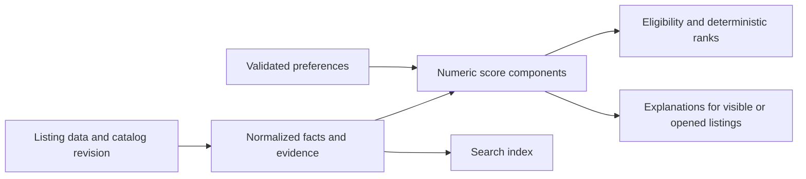

# Moradia: performance and correctness review

Reviewed 16 October 2026. Scope: the Next.js housing app, its scoring/search/map paths, dataset and enrichment APIs, preferences, and property chat. This document proposes changes; it does not implement them.

## Evidence and scope

The benchmark baseline is a source/data snapshot captured at **23:31:59 UTC (20:31:59 São Paulo)**, with 5,133 listings. Files and SHA-256 hashes are recorded in `/private/tmp/moradia-performance-review-20261016/manifest.json`. Other tasks were editing the live checkout during this review. Findings below refer to that baseline unless explicitly marked as later observations.

Measurements used Node v26.9.0 on an Apple M4 Pro. These are local CPU/serialization microbenchmarks, **not measured browser interaction times, production API latency, network transfer, or database performance**. No production mutations, scraping, or app fixes were performed for this review. Aggregate results are saved in [performance measurements](/Users/joao.guilherme/dev/nu/data-projects/docs/analysis/2026-10-16-moradia-performance-measurements.json).

At the verification checkpoint, **31 tests passed**, TypeScript passed, and ESLint reported **17 warnings and no errors**. Those results precede subsequent concurrent edits and are not a certification of the later moving checkout. Passing tests do not cover the counterexamples below.

## Measured baseline

| Operation | Result | Interpretation |
|---|---:|---|
| Full scoring, first invocation | 820 ms | Excludes JSON parsing and TypeScript compilation |
| Full scoring, 15 warm samples | **627 ms median; 686 ms p95** | Too much synchronous work for an interactive weight change |
| Parse snapshot JSON | 42.5 ms median | Repeated whole-dataset loading has a meaningful CPU cost |
| Parse photo cache JSON | 7.8 ms median | Additional cost before enrichment |
| Serialize snapshot JSON | 27.4 ms median | Another whole-dataset pass |
| Search for `varanda` | 16.2 ms median | Rebuilds searchable text for each candidate |
| Same search with precomputed text | **2.8 ms median** | Temporary prototype; identical membership and order for this query |
| Raw snapshot / local gzip | **21.56 MB / 3.25 MB** | File measurements; actual HTTP/Flight payload was not measured |
| Illustrative summaries / local gzip | 7.10 MB / 0.72 MB | About 78% smaller compressed, but not functionally equivalent yet |

The search prototype preserved results and ordering for three queries, including one with no matches. Median speedups were **3.4–5.7×**, with a **37.4 ms** one-time index build. That is evidence for this specific optimization, not a forecast for total app speed.

The scoring CPU profile places substantial self time in apartment nuance interpretation, redundant-highlight extraction, furniture classification, floor interpretation, and text normalization. This supports moving stable evidence extraction out of the reranking path. It does not establish how much faster an integrated implementation will be.

## 1. Make the score an auditable calculation — highest priority

**Correctness problems observed:**

- The final score includes safety, commute, and city adjustments that the returned breakdown omits. **4,974 of 5,133** baseline records have a discrepancy between the displayed components and total. The total and explanation should derive from the same component collection.
- Decimal areas fall between hard-coded bands: **72 m² earns +10, 72.5 m² receives −10, and 73 m² earns +6**. The calculation also ignores the configurable sweet-spot boundaries.
- Adding free-view evidence to an ambiguous floor range of 0–3 can make the score worse. Its low-floor penalty changes from −14 to −21 or −22; the separate +3.5 view bonus does not compensate. The explanation nevertheless says the penalty was mitigated. **302 baseline records enter these ambiguous-range branches**; this count does not imply every record's ranking changes by the same amount.
- Ranking includes **15 inactive listings** that otherwise pass eligibility. Equal score and price are resolved by input order, so reordering the dataset can change ranks.
- Unknown furnishing/elevator information can be presented or rewarded as established facts. Unknown evidence should remain distinguishable from a confirmed absence.

Evidence: [floor penalties](/Users/joao.guilherme/dev/nu/data-projects/apps/moradia/src/lib/scoring-engine.ts:1429), [area bands](/Users/joao.guilherme/dev/nu/data-projects/apps/moradia/src/lib/scoring-engine.ts:3048), [score total](/Users/joao.guilherme/dev/nu/data-projects/apps/moradia/src/lib/scoring-engine.ts:3087), [breakdown and ranking](/Users/joao.guilherme/dev/nu/data-projects/apps/moradia/src/lib/scoring-engine.ts:3199).

**Proposal:** represent every contribution as `{ruleId, points, evidence, confidence, explanation}`. Sum that collection for the total and render it for explanations. Use complete numeric intervals, explicit unknown states, an explicit ranking population, and a stable provider/listing-ID tie-breaker. Keep uncertainty penalties separate from positive amenity evidence.

**Acceptance criteria:** components reconcile to the rounded total; decimal boundaries have no accidental gaps; changing sweet-spot preferences changes the intended bands; inactive listings receive no active rank; input permutation preserves ranks; positive evidence cannot reduce the score unless an explicit competing rule explains why.

## 2. Extract facts once, then perform lightweight reranking

The app currently repeats text interpretation and explanation construction across all listings when scoring inputs change. The measured 627 ms median is the main CPU bottleneck found in this review.

**Proposal:** introduce a pure pipeline:

Cache facts by listing revision plus extraction/catalog versions. Key evaluated results by all scoring inputs, including dataset revision, scoring version, weights, and relevant options. Bound caches and invalidate them when evidence changes. Do not cache a weight-dependent calculation as a static fact.

Precompute search text using the same fields and normalization as the current implementation. Its invalidation must include derived searchable fields as well as raw data. Separate structured evidence from presentation text before making explanations lazy, so search behavior is preserved.

After this split, measure again. If numeric reranking still blocks interaction, put it in a worker and discard responses from superseded preference revisions. Moving existing work to a worker alone would retain unnecessary computation.

**Acceptance criteria:** intended score changes are explicitly approved; all other scores, filters, and ordering remain equivalent; unrelated UI state does not recompute facts; old worker results cannot replace newer results. Suggested initial engineering targets on the same machine are warm reranking below 100 ms and representative indexed searches below 5 ms median; these are proposed targets, not achieved results.

## 3. Make persistence atomic and reads side-effect free

Preference reads load a local fallback and, with a healthy database row, rewrite four local mirrors. Preference saves read/merge/write the entire shared document; favorites add another load. QA stores the whole history in one JSON row and merges disk state during reads. Concurrent read-modify-write operations can overwrite each other's changes, and database failures can be reported through apparently successful local state.

In the baseline, one warm preference GET performs one database SELECT and four mirror-write attempts; one QA GET performs a SELECT and two history-write attempts, with an additional UPSERT if disk merging changes the result. Visible preference polling runs every 10 seconds, and open idle chat polling every 3.5 seconds. Together that implies roughly **23 SELECTs and 58 file-write attempts per minute per open client**, excluding initialization, failures, and user actions. These are code-derived counts, not production telemetry. Pending chat polling is faster.

Evidence: [preference loading and saving](/Users/joao.guilherme/dev/nu/data-projects/apps/moradia/src/lib/preferences-store.ts:182), [QA persistence](/Users/joao.guilherme/dev/nu/data-projects/apps/moradia/src/app/api/qa/route.ts:272), [client polling](/Users/joao.guilherme/dev/nu/data-projects/apps/moradia/src/components/moradia-portal.tsx:2042).

**Proposal:**

- Make GET paths read-only. Move file imports/mirroring into explicit mutation or ingestion operations, preserving any external answer-import workflow.
- Store QA items independently and update them atomically. Use an authoritative deletion policy and seed only at explicit initialization.
- Version preferences and perform conditional field patches. Represent favorite changes as atomic per-key operations; show a failed save when durable persistence fails.
- Use revision/ETag responses, preserve unchanged client state, stop polling hidden tabs, and schedule each poll after the prior request completes with failure backoff.
- Resolve client save races: include `maxCommuteMinutes` in save dependencies; clear the dirty state only when the acknowledged revision equals the latest local revision; handle a quick A→B→A change without leaving the client permanently dirty.

**Acceptance criteria:** concurrent edits to independent fields survive; an older request cannot mark newer edits saved; repeated reads cause zero writes; unchanged polls cause no state replacement; failed persistence is visible and retryable.

## 4. Update map markers incrementally and preserve location meaning

The marker effect depends on the hovered property. It clears three layers and recreates markers/listeners when that value changes. The coordinate separation helper also runs 28 pairwise passes: approximately **1.26 million pair checks for 300 points**. This algorithm becomes expensive as the visible list grows and changes displayed coordinates to avoid overlap.

Evidence: [point separation](/Users/joao.guilherme/dev/nu/data-projects/apps/moradia/src/components/property-map-view.tsx:313), [layer rebuild](/Users/joao.guilherme/dev/nu/data-projects/apps/moradia/src/components/property-map-view.tsx:728), [effect dependencies](/Users/joao.guilherme/dev/nu/data-projects/apps/moradia/src/components/property-map-view.tsx:1069).

**Proposal:** keep markers in a map keyed by property ID, keep office markers stable, and update only the previous/new hovered marker and connector. Use clustering or explicit spiderfying for overlapping points, while retaining true coordinates and location precision in the data. For larger result sets, use viewport selection or a spatial index. The map currently receives an initial slice while load-more is in list mode; provide explicit map scope/loading instead of silently presenting that slice as the entire result set.

The geocoder compounds this issue: a request can contain 32 properties, but the server refines at most six. Returned fallback locations are stored as resolved client entries, so later passes can skip their refinement permanently.

**Acceptance criteria:** hover adds/removes zero property markers; unchanged listings retain markers; approximate locations are labeled; fallback results remain eligible for refinement; every visible listing is represented or the map explicitly states its scope. Avoid replacing the slice with all 5,133 points before addressing the quadratic layout.

## 5. Load compact listing summaries and indexed details

Photos, nearby-place data, descriptions, generated descriptions, and captions dominate the snapshot. A summary projection reduced local compressed size from 3.25 MB to 0.72 MB, but omitted detail/filter information needed by the current app. Shipping that projection directly would break functionality.

**Proposal:** serve a versioned summary containing all necessary filter/score facts and one cover photo. Load full galleries, descriptions, and nearby-place detail when opened. Cache parsed immutable snapshots and build a provider/ID lookup once per dataset revision. Preserve every existing search/filter field through the normalized facts/index contract before removing raw fields from the initial payload.

**Later live observation:** the photo endpoint now loads the full dataset before checking its photo cache to resolve a listing URL. That brings dataset parsing/enrichment and preference access into an otherwise cached photo request. Replace it with a dedicated indexed listing lookup while retaining URL validation.

Evidence: [dataset loading](/Users/joao.guilherme/dev/nu/data-projects/apps/moradia/src/lib/dataset-store.ts), [photo lookup before cache](/Users/joao.guilherme/dev/nu/data-projects/apps/moradia/src/app/api/photos/route.ts:434).

**Acceptance criteria:** cached photo lookup does not scan or enrich the entire dataset or load preferences; initial payload is measured in the actual browser; search/filter results remain equivalent; opening detail retrieves the correct dataset revision or explicitly handles its replacement.

## 6. Give enrichment requests a real lifecycle

Photo cache entries are considered hits only when they contain more than six images. A valid small gallery can therefore trigger repeated external work. Concurrent whole-cache read/modify/write operations can lose each other's updates. In the portal, a property is marked fetched before completion, and cancellation can leave it permanently marked, preventing retry. Card, modal, and parent also have independent fetching paths.

**Proposal:** use one shared client request cache and one server cache entry per listing, with `status`, `fetchedAt`, completeness, expiry, and the result. Deduplicate concurrent requests for the same key. Cache successful small galleries, apply a short expiry to empty/error results, and distinguish cancellation from successful completion. Return geocoding precision and refinement state explicitly; use a bounded retry queue and respect external provider limits.

The configured serial photo fallback path can consume up to roughly 49 seconds of timeout budgets locally, or 27 seconds when the browser fallback is skipped. These are upper budgets from code, not observed request durations. Make partial results and retry state visible instead of implying work has finished.

**Acceptance criteria:** one in-flight fetch per listing in each cache scope; small galleries hit cache; canceled/failed requests can retry; simultaneous enrichment of different listings preserves both results; fallback geocodes do not become falsely final.

## 7. Define what the city comparison actually measures

The section claims comparable residential standards but applies different price bands, area ranges, parking requirements, and modernity thresholds by city. Conditioning on different price ranges also biases the price comparison. Brasília uses a pooled median while other cities generally use the median of neighborhood medians. Neighborhoods with fewer than three records can disappear from statistics but remain in counts. `medianScore` is actually a mean, and some empty results become zero.

Examples from the baseline:

| City | Cohort listings | Displayed monthly statistic | Pooled listing median |
|---|---:|---:|---:|
| Brasília | 16 | R$4,309 | R$4,309 |
| Campinas | 109 | R$4,265 | R$4,342 |
| Belo Horizonte | 53 | R$5,133 | R$5,245 |
| Rio de Janeiro | 64 | R$5,827 | R$5,670 |
| São Paulo | 228 | R$5,762 | R$5,793 |

These are descriptive statistics of the app's selected listing sample, not market estimates. The furniture filter also combines the derived tier with the original boolean: some semi-furnished properties are rejected and others admitted. Many cohort records fail personalized eligibility. That can be legitimate for a market sample, but conflicts with calling the count `totalEligible` without defining its population.

Evidence: [cohort specifications and calculations](/Users/joao.guilherme/dev/nu/data-projects/apps/moradia/src/components/moradia-portal.tsx:2259).

**Proposal:** extract a pure benchmark function with an explicit cohort specification, furniture policy, estimator, and included/excluded counts. Use the same estimand across cities. Either standardize physical criteria for the claimed comparison or label city-specific cohorts accurately. Distinguish a personalized shortlist from a descriptive market sample, display small sample sizes, and use null for unavailable statistics.

**Acceptance criteria:** displayed counts match the observations used; the same estimator is used across cities; changing input order has no effect; missing data is never represented as a zero price/score; filtering on price is disclosed and is not presented as an unbiased market price comparison.

## 8. Consolidate preference migration and chat updates

The baseline migrates weights by matching numeric values to old defaults. A custom value of `urbanBreathingWeight: 1`, for example, is changed to 2 without evidence that the user intended a preset migration. Browser hydration follows a different path. Runtime numeric validation is also missing, allowing invalid values to contaminate scores.

**Later live observation:** a schema-version guard has been added, protecting version-2 preferences from repeated migration. Legacy custom values still need an explicit policy. The version should be a first-class persisted field, and preset versions should be distinct from user overrides.

Separately, each chat poll replaces the history array, and the drawer's scroll effect can move the reader to the bottom even when no message changed.

**Proposal:** share one validated preference schema and migration function between browser and server; preserve explicit custom overrides and reject non-finite/out-of-range weights. Reconcile chat by item revision and auto-scroll only on a new message when the reader is already near the bottom or submitted that message.

**Acceptance criteria:** browser/server migration results match; migration is idempotent; custom overrides survive; every accepted numeric setting yields finite calculations; unchanged polling preserves the reader's scroll position.

## Suggested delivery order

1. **Correct scoring and persistence:** reproducible invariants, complete breakdown, decimal bands, stable active ranking, versioned saves, and explicit failures.
2. **Remove repeated CPU and I/O work:** normalized facts, precomputed search, read-only GETs, indexed dataset access, and shared enrichment state.
3. **Improve interaction and payload size:** incremental map markers, honest map/geocode scope, compact summaries, and deferred detail loading.
4. **Make comparisons trustworthy:** explicit city cohorts and estimators, consistent labels/counts, and unavailable-data handling.

For each change, preserve a fixed dataset and preferences fixture, record before/after CPU and browser traces, and audit semantic differences. Re-run the live app checks after the concurrently edited implementation stabilizes. Later changes already underway include preference versioning, QA merge behavior, chat draft preservation, and additions to the score breakdown type; they require integration verification before being considered complete.
